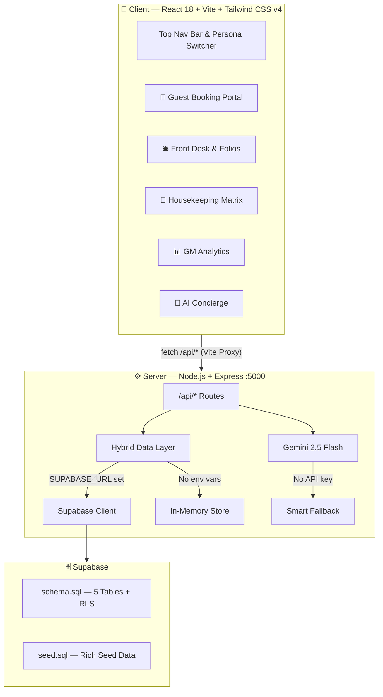

<div align="center">

# ✦ THE AURELIA GRAND & SUITES ✦

### Luxury Hotel Booking Engine & Property Management System

*An open-source, modular Full-Stack Hotel Booking Engine & Property Management System (PMS) template engineered for developers building hospitality SaaS products, boutique hotel portals, or short-let management platforms.*

[](https://react.dev)
[](https://nodejs.org)
[](https://tailwindcss.com)
[](https://supabase.com)
[](https://ai.google.dev)
[](LICENSE)

**Modular Dev Template v2.4**

</div>

---

## 🏨 What Is This?

The Aurelia Grand & Suites is a **production-grade, full-stack monorepo template** that gives developers a complete, working hotel booking engine with:

- **Guest-facing booking portal** with suite browsing, availability search, add-on customization, simulated checkout, and digital room key generation
- **Front Desk & Folio Manager** with arrivals/departures board, 1-click check-in/out, and real-time guest billing
- **Housekeeping Floor Matrix** with color-coded room status grids across 4 floors (16 rooms)
- **GM Revenue & Analytics Dashboard** with hospitality KPIs (Occupancy Rate, ADR, RevPAR), SVG charts, and AI-powered dynamic pricing recommendations
- **AI Concierge** powered by Google Gemini with intelligent fallback

> **Zero external dependencies required.** Clone → `npm install` → `npm run dev` → fully functional app with seeded data. No database, no API keys, no environment variables needed.

---

## 🏗️ Architecture



---

## 📂 Monorepo Structure

```
aurelia-grand-hotel-pms/
├── client/                          # React 18 + Vite + Tailwind CSS v4
│   ├── src/
│   │   ├── App.jsx                  # Shell, state management, view routing
│   │   ├── api.js                   # API client with fallback mock layer
│   │   ├── index.css                # Tailwind v4 @theme (Obsidian & Gold)
│   │   └── components/
│   │       ├── Header.jsx           # Luxury nav + brand crest
│   │       ├── PersonaSwitcher.jsx  # 4-role instant tab switcher
│   │       ├── CurrencyToggle.jsx   # USD ↔ NGN live toggle
│   │       ├── DevSpecsModal.jsx    # Developer template specs
│   │       ├── GuestPortal.jsx      # View 1: Booking portal
│   │       ├── SuiteCard.jsx        # Suite showcase card
│   │       ├── ReservationDrawer.jsx# 3-step booking flow
│   │       ├── ConfirmationCard.jsx # Boarding-pass confirmation
│   │       ├── AIConcierge.jsx      # Floating AI chat drawer
│   │       ├── FrontDesk.jsx        # View 2: Arrivals & departures
│   │       ├── FolioModal.jsx       # Guest billing modal
│   │       ├── Housekeeping.jsx     # View 3: Floor status matrix
│   │       ├── Analytics.jsx        # View 4: GM dashboard
│   │       ├── OccupancyChart.jsx   # SVG occupancy trend
│   │       ├── RevenueChart.jsx     # SVG revenue bars
│   │       └── ChannelMixChart.jsx  # SVG donut chart
│   └── vite.config.js              # Proxy + Tailwind plugin
├── server/                          # Node.js + Express
│   ├── index.js                     # Entry point (port 5000)
│   ├── data/
│   │   └── seedData.js              # In-memory seed data
│   ├── store/
│   │   └── memoryStore.js           # Stateful CRUD operations
│   └── routes/
│       ├── suites.js                # Suite browsing & availability
│       ├── reservations.js          # Booking CRUD + status flows
│       ├── folio.js                 # Guest billing & charges
│       ├── housekeeping.js          # Room status management
│       ├── analytics.js             # KPI calculations
│       └── concierge.js             # AI concierge (Gemini + fallback)
├── supabase/
│   ├── schema.sql                   # PostgreSQL schema + RLS policies
│   └── seed.sql                     # 6 suites, 8 guests, 8 reservations
├── package.json                     # Root scripts (dev, server, client)
└── README.md
```

---

## 🚀 Quick Start

### Prerequisites
- **Node.js** 18+ (tested on 24.x)
- **npm** 9+

### 1. Clone & Install

```bash
git clone https://github.com/your-org/aurelia-grand-hotel-pms.git
cd aurelia-grand-hotel-pms
npm run install:all
```

### 2. Run (Zero Config)

```bash
# Start both server (:5000) and client (:5173) concurrently
npm run dev
```

Open **http://localhost:5173** and use the **1-Click Persona Switcher** to explore all four views instantly — no login required.

### 3. Optional: Connect Supabase

```bash
# server/.env
SUPABASE_URL=https://your-project.supabase.co
SUPABASE_ANON_KEY=your-anon-key
```

Then run the SQL files in your Supabase dashboard:
1. Execute `supabase/schema.sql` to create tables and RLS policies
2. Execute `supabase/seed.sql` to populate initial data

### 4. Optional: Enable AI Concierge

```bash
# server/.env
GEMINI_API_KEY=your-gemini-api-key
```

---

## 👥 Role-Based Views (No Login Wall)

| View | Persona | Description |
|------|---------|-------------|
| **👑 Guest Portal** | Chidi Okafor — Black Tier VIP | Browse suites, search availability, customize add-ons, book with simulated payment, receive digital room key |
| **🛎️ Front Desk** | Amara Nwosu — Duty Manager | Manage arrivals/departures, check-in/out guests, assign rooms, manage folios |
| **🧹 Housekeeping** | Tunde Bakare — Floor Supervisor | Visual floor matrix, color-coded room status, toggle clean/dirty/maintenance, assign attendants |
| **📊 GM Analytics** | Elena Rostova — General Manager | Occupancy KPIs, revenue charts, channel mix analysis, AI pricing recommendations |

---

## 💱 Live Currency Toggle

All prices across the entire application switch instantly between:
- **USD ($)** — Base currency
- **NGN (₦)** — Nigerian Naira at ₦1,580 / $1 conversion rate

---

## 🔌 API Reference

All endpoints are prefixed with `/api`. The server runs on port **5000**.

### Suites
| Method | Endpoint | Description |
|--------|----------|-------------|
| `GET` | `/api/suites` | List all suites. Query: `?available_from=DATE&available_to=DATE` |
| `GET` | `/api/suites/:id` | Get suite by UUID or slug |

### Reservations
| Method | Endpoint | Description |
|--------|----------|-------------|
| `GET` | `/api/reservations` | List all reservations with joins. Query: `?status=`, `?search=` |
| `GET` | `/api/reservations/:id` | Get by UUID or booking ref (e.g., `AUR-2026-0001`) |
| `POST` | `/api/reservations` | Create booking (auto-generates ref, calculates taxes) |
| `PATCH` | `/api/reservations/:id` | Update status (check-in/out syncs with housekeeping) |

### Folio (Guest Billing)
| Method | Endpoint | Description |
|--------|----------|-------------|
| `GET` | `/api/folio/:reservationId` | Get all charges for a reservation |
| `POST` | `/api/folio/:reservationId` | Add incidental charge |
| `PATCH` | `/api/folio/:reservationId/settle` | Settle balance (mark all paid) |

### Housekeeping
| Method | Endpoint | Description |
|--------|----------|-------------|
| `GET` | `/api/housekeeping` | Get all 16 rooms sorted by floor |
| `PATCH` | `/api/housekeeping/:roomNumber` | Update status, attendant, notes |

### Analytics & AI
| Method | Endpoint | Description |
|--------|----------|-------------|
| `GET` | `/api/analytics` | KPIs: occupancy, ADR, RevPAR, channel mix, 14-day trends |
| `POST` | `/api/concierge` | AI Concierge (Gemini 2.5 Flash with smart fallback) |

---

## 🧩 Reusable Component Library

These components are designed to be extracted and used in your own hospitality projects:

| Component | Purpose | Reusability |
|-----------|---------|-------------|
| `SuiteCard` | Property/room showcase card with photo, amenities, pricing | Any listing (Airbnb, hotel, real estate) |
| `ReservationDrawer` | Multi-step booking flow with add-ons & checkout | Any e-commerce checkout |
| `ConfirmationCard` | Boarding-pass style booking confirmation with QR | Tickets, boarding passes, event confirmations |
| `FolioModal` | Itemized billing with add-charge & settle | Any invoicing or billing UI |
| `Housekeeping` | Visual floor/status matrix with color coding | Facility management, maintenance dashboards |
| `OccupancyChart` | Pure SVG time-series bar chart | Any analytics dashboard |
| `ChannelMixChart` | Pure SVG donut/pie chart | Any distribution visualization |
| `AIConcierge` | Floating AI chat with quick prompts | Any customer support widget |
| `PersonaSwitcher` | Role-based view toggle without auth | Demos, prototypes, portfolio projects |
| `CurrencyToggle` | Multi-currency live switch | Any international pricing UI |

---

## 🗄️ Database Schema

### Tables

| Table | Description | Key Fields |
|-------|-------------|------------|
| `suites` | 6 luxury suites with rates, amenities, photos | UUID PK, category enum, base_rate_usd, amenities[] |
| `guests` | Guest profiles with VIP tiers | UUID PK, vip_tier enum (black → member) |
| `reservations` | Bookings with date-range overlap protection | UUID PK, booking_ref, EXCLUDE constraint, JSONB addons |
| `folio_items` | Itemized guest charges | FK → reservations, category enum |
| `housekeeping_tasks` | Room status across 4 floors (16 rooms) | room_number, status enum, attendant, priority |

### Row-Level Security (RLS)
- Suites: publicly readable
- Guests: read own profile only
- Reservations: guests see own, staff sees all
- Housekeeping & Folios: staff-only full access

---

## 🎨 Design System

### Color Palette: Obsidian & Champagne Gold

| Token | Hex | Usage |
|-------|-----|-------|
| `obsidian` | `#0A0D14` | Page background |
| `elevated` | `#121722` | Cards, modals, drawers |
| `card-border` | `#1E2433` | Subtle borders |
| `gold` | `#D4AF37` | Primary accent, CTAs |
| `gold-hover` | `#E5C453` | Hover states |
| `text-primary` | `#F5F5F5` | Headings, emphasis |
| `text-secondary` | `#9CA3AF` | Body text, labels |
| `emerald` | `#10B981` | Available, Clean |
| `rose` | `#F43F5E` | Dirty, Urgent |
| `amber` | `#F59E0B` | In Progress |
| `slate-muted` | `#64748B` | Maintenance |

### Typography
- **Display**: Playfair Display (serif) — headings
- **Body**: Inter (sans-serif) — UI text

---

## 🔧 Environment Variables

| Variable | Required | Default | Description |
|----------|----------|---------|-------------|
| `SUPABASE_URL` | No | — | Supabase project URL (falls back to in-memory) |
| `SUPABASE_ANON_KEY` | No | — | Supabase anon key |
| `GEMINI_API_KEY` | No | — | Google Gemini API key (falls back to keyword engine) |
| `PORT` | No | `5000` | Express server port |
| `VITE_API_URL` | No | `''` | Frontend API base URL (for production deployments) |

---

## 🚢 Deployment

### Vercel / Render

The `API_BASE` pattern (`import.meta.env.VITE_API_URL || ''`) allows seamless deployment:

```bash
# Build the client
cd client && npm run build

# Set VITE_API_URL to your server's URL in production
VITE_API_URL=https://api.your-domain.com npm run build
```

### Docker (Example)

```dockerfile
FROM node:24-alpine
WORKDIR /app
COPY . .
RUN cd server && npm install
RUN cd client && npm install && npm run build
EXPOSE 5000
CMD ["node", "server/index.js"]
```

---

## 📄 License

MIT License. Use freely for commercial and personal projects.

---

<div align="center">

**Built with ✦ by developers, for the hospitality industry.**

*Clone it. Customize it. Ship it.*

</div>

